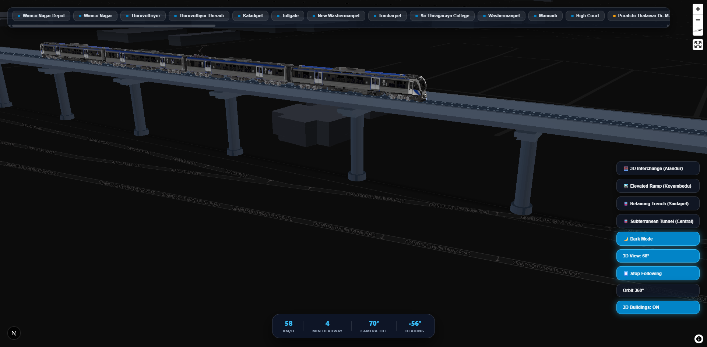

# Chennai Metro 3D Tracking | MapLibre GL JS + Three.js

A high-fidelity, interactive 3D digital twin and real-time tracking visualization for the **Chennai Metro Rail (CMRL)** network, built using **Next.js**, **Three.js**, and **MapLibre GL JS**.



## 🚆 Key Features

- **High-Fidelity 3D Rolling Stock**:
  - Exact 3D electric passenger train models rendered with official Chennai Metro Phase 2 livery: Electric Royal Blue (`#1d4ed8`), metallic pearl stainless steel carbody, dark obsidian tinted glass, and white CMRL crest nose medallion.
  - Active roof pantographs on motor coaches and clean aerodynamic roofs on trailer coaches.
  - Glowing amber LED destination displays (`[● LIGHT HOUSE]`, `[● CENTRAL METRO]`).
  - Warm projector LED headlights and ruby red rear tail markers.

- **Two-Bogie Kinematics Simulation**:
  - Real chord-based bogie kinematics ($2b = 17.1\text{m}$ wheelbase) where wheelsets stay rigidly locked to track rails even on tight 50m radius curves (e.g., Kathipara / Alandur interchange flyovers).
  - Smoothly articulated rubber accordion gangways connecting adjacent cars without gaps or separation.

- **Continuous 3D Structural Viaducts & Infrastructure**:
  - Slate-blue running decks with structural concrete box girder soffits and chamfer webs.
  - Heavy-duty cylindrical piers with aerodynamic cantilever hammerhead crosshead beams.
  - Dual elevated steel rails with green and blue power indicator stripes.
  - Elevated passenger stations with glass canopies, platform decks, and portal bent framing.
  - Realistic tunnel portal arches and retaining trench transitions (Saidapet, Thirumangalam, Tondiarpet).

- **Dynamic Environment & Solar Positioning**:
  - Solar azimuth and elevation calculated from real-world date/time and Chennai coordinates (`13.0827° N, 80.2707° E`).
  - Day / Night theme switching with soft shadows and metallic reflections.

## 🛠️ Tech Stack

- **Framework**: [Next.js 16 (App Router + Turbopack)](https://nextjs.org/)
- **3D Graphics Engine**: [Three.js](https://threejs.org/)
- **Map & Geospatial Layer**: [MapLibre GL JS](https://maplibre.org/)
- **Language**: TypeScript

## 🚀 Getting Started

1. **Clone the repository**:
   ```bash
   git clone https://github.com/karthi-techdev/chennai-metro-3d.git
   cd chennai-metro-3d
   ```

2. **Install dependencies**:
   ```bash
   npm install
   ```

3. **Run development server**:
   ```bash
   npm run dev
   ```

4. **Open in browser**:
   Navigate to [http://localhost:3000](http://localhost:3000).

## 📄 License

MIT License. Designed and developed for Chennai Metro 3D visualization.
